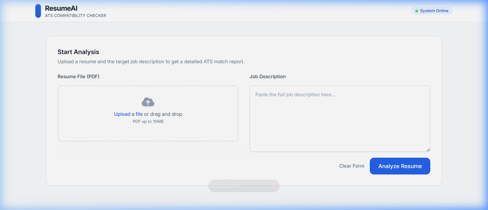
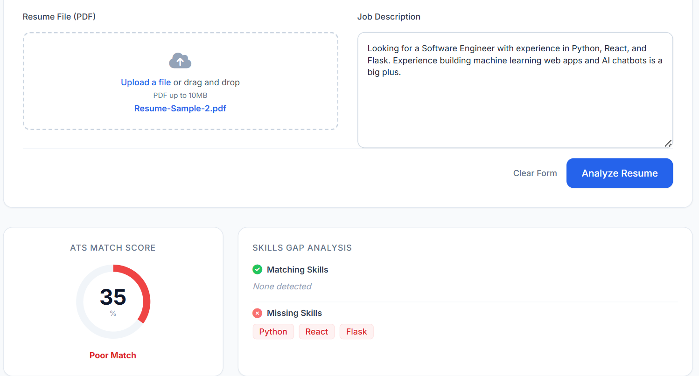
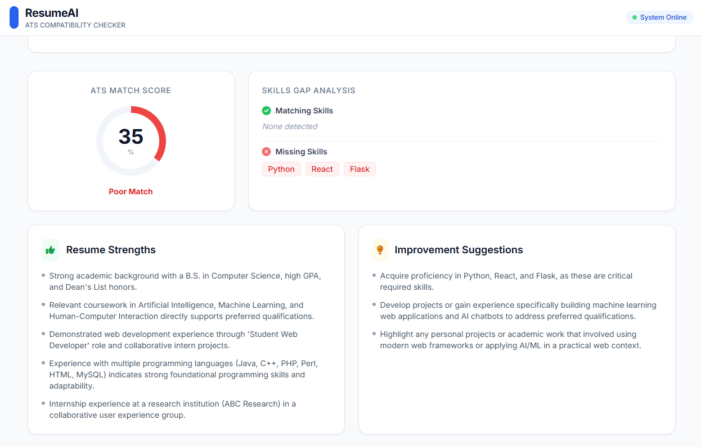

# 📄 ATS Resume Analyzer

An AI-powered Applicant Tracking System (ATS) that analyzes resumes against job descriptions to provide match scores, skill gap analysis, and actionable improvement suggestions — powered by **Google Gemini 3.8 Flash**.


---

## 📸 Demo

Below is a demonstration of the ATS Resume Analyzer in action:

### 🌟 Landing Page


### 📊 Evaluation Results (Match Score & Skills Gap)


### 💡 Resume Strengths & Improvement Suggestions


---

## ✨ Features

- **📑 PDF Resume Upload** — Upload your resume in PDF format via an intuitive drag-and-drop interface.
- **📝 Job Description Input** — Paste any target job description for customized analysis.
- **🎯 ATS Match Score** — Receive an objective percentage-based compatibility score (0–100%) with an animated circular gauge.
- **✅ Matching Skills Detection** — Instantly view which of your skills align with the job requirements (highlighted in green).
- **❌ Missing Skills Identification** — Identify critical skill gaps needed for the role (highlighted in red).
- **💪 Strengths Analysis** — Highlight what makes your profile competitive.
- **💡 Actionable Improvement Suggestions** — Receive tailored recommendations to beat ATS filters.
- **🔍 Parsed Data Viewer** — Expandable collapsible section to inspect the raw parsed resume and extracted job criteria.
- **🛡️ Built-in Resilience** — Exponential backoff retry mechanism to gracefully handle Gemini API overload (503) or rate limits.

---

## 🛠️ Tech Stack

| Layer | Technology |
|---|---|
| **Backend** | Python, Flask, Gunicorn |
| **AI Model** | Google Gemini 3.8 Flash (`google-genai`) |
| **PDF Parser** | PyPDF2 |
| **Frontend** | HTML5, Tailwind CSS (CDN), Vanilla JavaScript |
| **Icons** | Font Awesome 6 |
| **Deployment** | Render / Production WSGI |

---

## 📂 Project Structure

```
ATS-Resume-Analyzer/
├── assets/                  # Screenshots and demo images
│   ├── ats_landing.png
│   ├── image.png
│   └── image2.png
├── templates/
│   └── index.html           # Frontend UI (Tailwind CSS + JavaScript)
├── uploads/                 # Temporary PDF storage (gitignored)
├── main.py                  # Core Flask backend with Gemini AI integration
├── requirements.txt         # Project dependencies
├── .env.example             # Example environment variable file
├── .gitignore               # Git ignored files & directories
└── README.md                # Project documentation
```

---

## 🚀 Getting Started

### Prerequisites

- **Python 3.9+** installed on your system.
- A **Google Gemini API Key** ([Get your free key at Google AI Studio](https://aistudio.google.com/apikey)).

### Local Installation

1. **Clone the repository**
   ```bash
   git clone https://github.com/sujitha-kotyada/ATS-Resume-Analyzer.git
   cd ATS-Resume-Analyzer
   ```

2. **Create a virtual environment**
   ```bash
   python -m venv .venv
   ```

3. **Activate the virtual environment**
   - **Windows (PowerShell):**
     ```powershell
     .\.venv\Scripts\Activate.ps1
     ```
   - **macOS/Linux:**
     ```bash
     source .venv/bin/activate
     ```

4. **Install dependencies**
   ```bash
   pip install -r requirements.txt
   ```

5. **Configure your API key**
   Copy the example environment file and add your Gemini API key:
   ```bash
   cp .env.example .env
   ```
   Edit `.env` and set your key:
   ```env
   GEMINI_API_KEY=your_gemini_api_key_here
   ```

6. **Run the application**
   ```bash
   python main.py
   ```

7. **Open in your browser**
   Navigate to [http://localhost:8080](http://localhost:8080)

---

## 🌐 Deployment (Render)

This application is ready for 1-click deployment on **[Render](https://render.com/)**:

1. **Create a Web Service** on Render and connect your GitHub repository.
2. **Configure Service Settings**:
   - **Runtime:** `Python 3`
   - **Build Command:** `pip install -r requirements.txt`
   - **Start Command:** `gunicorn --timeout 120 main:app`
3. **Environment Variables**:
   Under the **Environment** tab, add:
   - **Key:** `GEMINI_API_KEY`
   - **Value:** `your_actual_gemini_api_key`
4. Click **Deploy Web Service**.

> **Note on Timeout:** Setting `--timeout 120` in the start command ensures multi-step Gemini API processing completes smoothly without Gunicorn worker timeouts.

---

## 📖 How to Use

1. **Upload** your resume PDF using the drag-and-drop zone.
2. **Paste** the target job description into the text area.
3. Click **"Analyze Resume"** and allow the AI to evaluate your profile.
4. Review your results:
   - **ATS Match Score**: Visual circular progress gauge.
   - **Matching Skills**: Green-tagged skills you already have.
   - **Missing Skills**: Red-tagged skills to consider adding or learning.
   - **Strengths**: Standout qualifications identified by Gemini.
   - **Suggestions**: Specific recommendations to optimize your resume.

---

## 🔌 API Reference

### `POST /analyze`

Analyzes a resume against a job description.

**Request:** `multipart/form-data`

| Field | Type | Required | Description |
|---|---|---|---|
| `resume` | File | Yes | PDF resume file |
| `job_description` | String | Yes | Plain text job description |

**Sample Response (`200 OK`):**
```json
{
  "ats_result": {
    "match_score": 75,
    "matching_skills": ["Python", "Flask", "REST APIs"],
    "missing_skills": ["Docker", "Kubernetes"],
    "strengths": ["Strong backend experience", "Relevant project portfolio"],
    "improvement_suggestions": ["Add cloud deployment experience", "Highlight CI/CD workflows"]
  },
  "parsed_resume": "Bullet-point summary of parsed resume...",
  "parsed_job_description": "Bullet-point summary of parsed job description..."
}
```

---

## 🛡️ Resilience & Production Notes

- **Model Compatibility**: Uses Google's latest **`gemini-3.8-flash`** model.
- **Retry Mechanism**: Includes exponential backoff retry for handling Gemini API `503 UNAVAILABLE` overload errors.
- **Encoding Safety**: Built-in safe UTF-8/Unicode decoding handles special bullet symbols (e.g., `\uf0a7`) commonly found in PDF resumes without crashing.
- **Secure File Handling**: Uploaded PDF files in `uploads/` are temporary and excluded from git tracking.

---

## 📄 License

This project is open source and available under the [MIT License](LICENSE).

---

## 👩‍💻 Author

**Sujitha Kotyada** — [@sujitha-kotyada](https://github.com/sujitha-kotyada)
